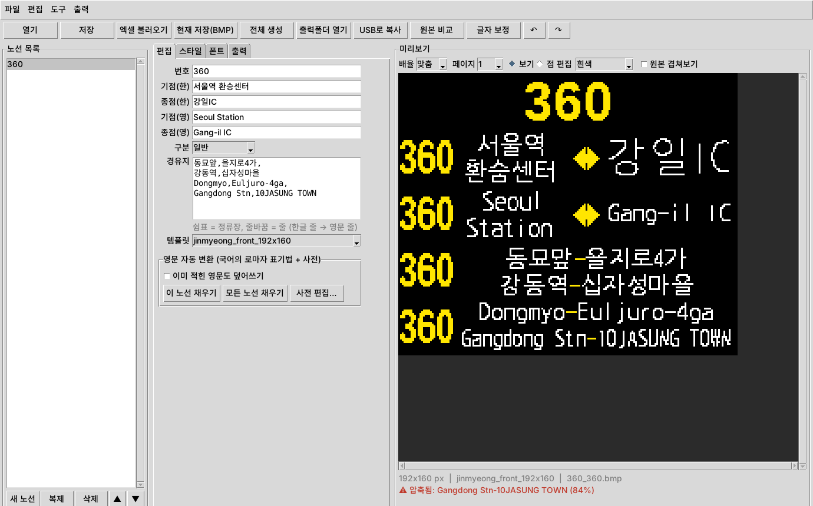
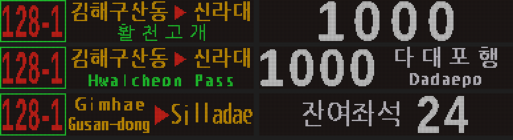
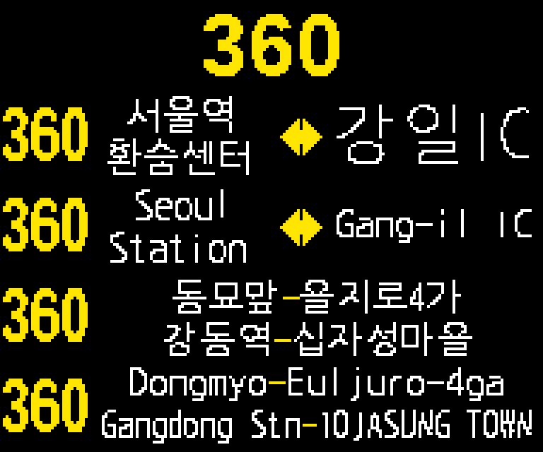
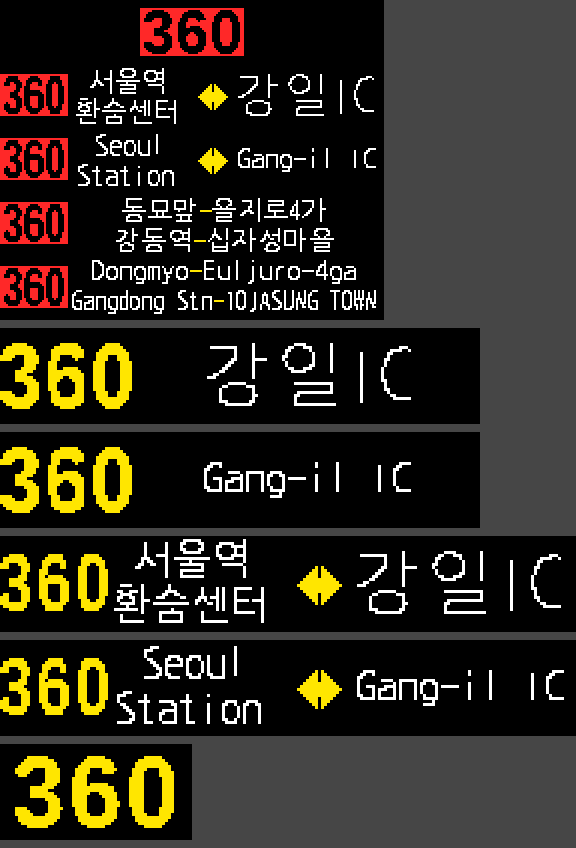
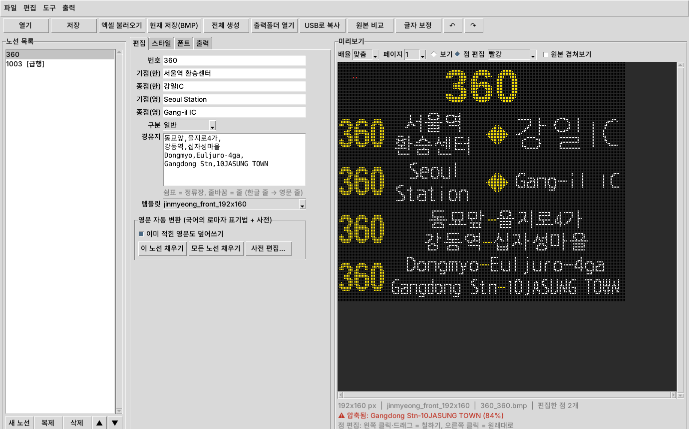
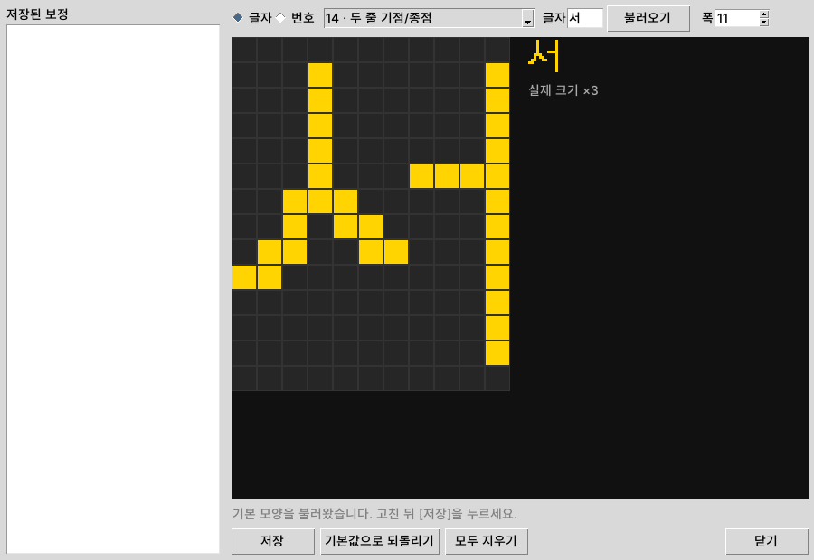
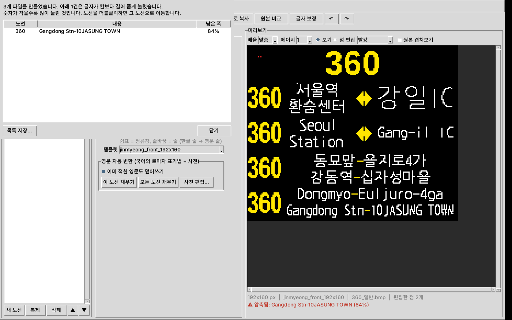

# 노선이미지 생성기 (Bus Sign Maker)

버스 LED 행선판(전면 192×160 등)에 넣을 **노선 이미지(BMP)** 를 만드는 맥·윈도우·리눅스용 프로그램입니다.
윈도우 전용 행선판 관리 프로그램에서 쓰던 노선 이미지 작업을 맥에서도 할 수 있게 만들었고,
원본 프로그램이 만든 화면을 점 단위로 분석해서 배치·크기·숫자 모양을 최대한 똑같이 맞췄습니다.



## 내려받기

[**Releases**](https://github.com/M32k/bus-sign-maker/releases/latest)에서 운영체제에 맞는 파일을 받으세요.

| 운영체제 | 파일 |
|---|---|
| 윈도우 10/11 | `BusSignMaker-Windows.exe` — 설치 없이 바로 실행 |
| 맥 (애플 실리콘) | `BusSignMaker-macOS-AppleSilicon.dmg` |
| 리눅스 (x86_64) | `BusSignMaker-Linux-x86_64.tar.gz` — 압축 풀고 `./BusSignMaker` 실행 |

릴리스 파일은 GitHub Actions가 윈도우·맥 서버에서 직접 빌드하고, 자체검사를 통과한 것만 올라갑니다.
처음 실행할 때 나오는 보안 경고는 [릴리스 설명](.github/RELEASE_NOTES.md)을 참고하세요.



| 출력 예 (192×160, 4배 확대) | 지원하는 판 |
|---|---|
|  |  |

## 주요 기능

- **부산 구형 3색 LED (192×32)**: 실제 부산 시내버스 구형 전광판 영상을 보고 만든 템플릿입니다.
  큰 번호 → 경유지(한글·영문 번갈아) → 행선(한·영·일·중) 순서로 여러 장을 만들고, 효과 없이 바로 다음 화면으로 넘어가며 재생됩니다.
  번호 상자는 실제처럼 검은 바탕·빨간 숫자·초록 테두리가 기본이고(다른 모양도 선택 가능), 가진 로고 이미지를 한 장면으로 넣을 수 있습니다.
  글자는 주황, 번호는 빨강, 경유지는 초록 한 색이고, 기점과 종점 사이에는 빨간 삼각형(▶)이 들어갑니다(`구형 화살표`에서 굵은 화살표 ➡ 선택 가능). 번호 상자는 128-1처럼 긴 번호면 넓어지고, 한글 경유지는 '활 천 고 개'처럼 글자 사이를 벌려 씁니다.
- **부산 신형 풀컬러 LED (192×32)**: 바뀐 부산 시내버스 전면 전광판 영상을 보고 만든 템플릿입니다.
  [큰 번호] → [번호 + 'OO행'] → [번호 + 'O O 행' + 영어] → [… + 중국어] → [… + 일본어] → 잔여좌석 → 문구 순서이고, 효과 없이 바로 다음 화면으로 바뀝니다. 번호 옆 'OO행'은 1000번 영상처럼 번호의 80%쯤 되는 큰 굵은 글씨로 나옵니다. 중국어·일본어는 `종점(중)`·`종점(일)` 칸이 비어 있으면 내장 부산 지명 사전(다대포 → 多大浦, 부산역 → 釜山站/釜山駅 등)에서 찾고, `~/BusSignMaker/translate_dict.json`에 직접 추가할 수도 있습니다. 사전에 없으면 일본어는 가타카나로 소리 나는 대로(고원아파트 → コウォンアパート) 쓰고, 중국어는 한자를 알 수 없어 생략하며 경고로 알려 줍니다. 경유지는 측면 신형 전광판처럼 흰 글자 + 파란 ▶로 판 전체에 두 줄씩 채워서 한 화면에 5~7개가 보이고(한글 다음 영문), 넘치면 다음 화면으로 이어집니다. 스타일 탭 `신형 경유지 화면`에서 '끔'으로 뺄 수 있습니다. 번호 옆 행선지가 길면 실제 전광판처럼 '행'을 빼고 크게 씁니다(해운대해수욕장, 동부산관광단지). 긴 영문은 고정폭으로 누르지 않고 비례폭 굵은 글씨로 씁니다.
  번호는 흰색 굵은 숫자이고(스타일 탭 `신형 번호색`에서 '구분별 색'·'빨강→분홍'으로 바꿀 수 있음), 'Busan is good' 같은 문구는 분홍입니다.
- **잔여좌석 화면**: `잔여좌석` 칸에 숫자를 넣으면 구형(빨간 '잔여좌석' + 주황 숫자)·신형(글자·숫자 모두 흰색) 모두 '잔여좌석 24' 화면이 추가됩니다.
- **사진처럼 보이는 미리보기**: [LED 모양]을 켜면 둥근 LED 점과 빛 번짐으로 실제 전광판처럼 보이고, [▶ 재생]으로 움직임을 확인합니다.
  **움직이는 GIF**로도 저장할 수 있습니다(출력 → 움직이는 GIF로 저장).
- **엑셀로 일괄 생성**: 번호·기점·종점(한/영)·경유지·구분을 엑셀에서 불러와 한 번에 BMP로 만듭니다.
- **원본과 같은 배치**: 줄 위치·글자 칸(한글 13칸 / 영문 7칸 고정폭)·번호 글꼴·화살표를 원본 화면에 맞췄습니다.
- **1픽셀 균일 획**: 글자를 중심선으로 깎았다가 다시 칠해서, LED처럼 모든 획 두께가 똑같습니다.
- **점 편집**: 미리보기에서 점을 직접 켜고 끕니다. 노선마다 저장됩니다.
- **글자 보정표**: 글자 하나를 크기별로 고쳐 두면, 그 글자가 나오는 모든 노선에 자동 적용됩니다.
- **원본 BMP 비교**: 원본 프로그램이 만든 BMP와 겹쳐보기·일치율(정확 / 1칸 오차 허용)을 보여줍니다.
- **압축 경고**: 글자가 칸보다 길어 좁게 눌린 노선을 목록으로 알려줍니다.
- **영문 자동 변환**: 국어의 로마자 표기법(연음·비음화·유음화·구개음화 반영) + 사용자 사전(`역 → Stn` 등).
- **여러 판 종류**: 전면 192×160, 부산 구형 3색·신형 풀컬러 192×32, 측면 160×32(한/영 2장), 전면 한 줄 192×32, 후면 64×32. JSON으로 새 판 추가 가능.
- **노선 구분 표시**: 급행·좌석·심야·마을·순환별 번호 색 / 반전(색 상자) 표시.
- **출력 옵션**: BMP 24/8/4/1비트, 파일 이름 규칙(`{no}_{no}` 등), 출력 폴더, USB 복사.
- **프로젝트 관리**: 프로젝트 저장(.bsm), 되돌리기/다시 실행, 노선 복제·삭제·순서 변경, 엑셀 내보내기.
- **회사 프리셋**: 색·화살표·글꼴·구분 표시 조합을 이름 붙여 저장합니다.

| 점 편집 | 글자 보정 | 압축 경고 |
|---|---|---|
|  |  |  |

## 소스로 실행

Python 3.10 이상(tkinter 포함)이 필요합니다.

### 리눅스

```bash
# 1) tkinter 설치 (한 번만)
sudo apt install python3-tk python3-venv      # Ubuntu / Debian / Mint
sudo dnf install python3-tkinter              # Fedora
sudo pacman -S tk                             # Arch

# 2) 받아서 실행 — 처음에는 가상환경을 알아서 만듭니다
git clone https://github.com/M32k/bus-sign-maker
cd bus-sign-maker
bash run_linux.sh              # 프로그램 실행
bash run_linux.sh --selftest   # 자체검사
```

릴리스의 `BusSignMaker-Linux-x86_64.tar.gz`를 쓰면 파이썬 없이도 바로 실행됩니다.

```bash
tar xzf BusSignMaker-Linux-x86_64.tar.gz
./BusSignMaker-Linux-x86_64/BusSignMaker
```

### 맥 / 윈도우

```bash
pip3 install "pillow==12.3.0" "numpy==2.5.3" "openpyxl==3.1.5"
python3 bus_sign_maker.py
```

> 버전을 고정하는 이유: 글자 픽셀은 라이브러리 버전에 따라 미세하게 달라질 수 있어서, 검증한 버전으로 맞춥니다.

## 맥 앱(.dmg) 만들기

```bash
bash build_dmg.command
```

1. tkinter가 되는 파이썬을 찾고(python.org 설치판 권장)
2. 빌드용 가상환경에 고정 버전 라이브러리를 설치한 뒤
3. **자체검사**(기준 이미지 21세트와 픽셀 단위 비교)를 통과해야만
4. PyInstaller로 `.app`을 만들고 `BusSignMaker.dmg`를 생성합니다.

자체검사만 따로 돌리려면:

```bash
python3 bus_sign_maker.py --selftest
```

## 엑셀 형식

첫 줄은 제목 줄입니다. 바로 써 볼 수 있는 예시가 [`samples/노선샘플.xlsx`](samples/노선샘플.xlsx)에 있습니다
(프로그램의 `파일 → 샘플 엑셀 만들기`로도 같은 파일을 만들 수 있습니다).
부산 구형·신형(잔여좌석 포함)을 비롯해 급행·좌석·심야·마을·순환, 측면·전면 한 줄·후면판, 영문이 빈 노선(자동 변환 연습용), 압축 경고 예시가 들어 있고,
두 번째 시트 `사용법`에 열 설명이 있습니다.

| 번호 | 기점(한) | 종점(한) | 기점(영) | 종점(영) | 경유지 | 템플릿 | 구분 |
|---|---|---|---|---|---|---|---|
| 360 | 서울역 환승센터 | 강일IC | Seoul Station | Gang-il IC | (아래 참고) | jinmyeong_front_192x160 | 일반 |

기점·종점에 `김해|구산동`처럼 `|`(또는 엑셀 칸 안 줄바꿈)를 넣으면, 두 줄로 쓰는 화면에서 그 자리에서 줄을 바꿉니다(한 줄 화면에는 `김해구산동`으로 나옴). 부산 구형 3색에서 영문·일본어·중국어 기점·종점을 비워 두면 한글에서 자동으로 바꾼 행선 화면이 들어갑니다(`김해|구산동` → Gimhae / Gusan-dong, 金海 / クサンドン). 일본어·중국어는 내장 부산 지명 사전에서 찾고, 일본어는 사전에 없으면 가타카나로 쓰며, 중국어는 모르면 그 화면을 생략하고 경고로 알려 줍니다.

부산 구형 3색·신형 풀컬러 템플릿은 `기점(일)` `종점(일)` `기점(중)` `종점(중)` `문구` `로고 이미지` `잔여좌석` 열도 씁니다(비워 두면 그 화면은 생략).

경유지 칸은 **쉼표 = 정류장, 줄바꿈 = 줄**이고, 한글 줄 다음에 영문 줄을 씁니다.

```
동묘앞,을지로4가
강동역,십자성마을
Dongmyo,Euljiro 4-ga
Gangdong Stn,Sipjaseong Village
```

## 새 판(템플릿) 추가

`~/BusSignMaker/templates/`에 JSON 파일을 넣으면 템플릿 목록에 나타납니다(같은 폴더의 예시 파일 참고).

```json
{
  "name": "내 측면판 160x32",
  "width": 160, "height": 32,
  "pages": [
    {"name": "한글", "elements": [
      {"type": "number", "x": 0, "y": 0, "w": 44, "h": 32, "digit_h": 22},
      {"type": "text", "text": "{end_ko}", "x": 46, "y": 0, "w": 114, "h": 32,
       "one": "big_ko", "two": "ko_two", "color": "end"}
    ]}
  ]
}
```

- `type`: `number`(번호) · `text`(글자) · `arrow`(화살표)
- `text`에는 `{start_ko} {end_ko} {start_en} {end_en} {via_ko} {via_en} {no}`를 쓸 수 있습니다.
- `one` / `two`: 한 줄·두 줄일 때 글자 규격 — `big_ko`, `ko_two`, `en_two`, `en_one`, `via_ko`, `via_en`, `small`, `tiny`

## 사용자 파일 위치

| 파일 | 내용 |
|---|---|
| `~/BusSignMaker/output/` | 기본 출력 폴더 |
| `~/BusSignMaker/presets.json` | 회사 프리셋 |
| `~/BusSignMaker/glyphs.json` | 글자 보정표 |
| `~/BusSignMaker/romanize_dict.json` | 영문 변환 사전 |
| `~/BusSignMaker/templates/` | 사용자 템플릿 |
| `~/BusSignMaker/fonts/` | 추가 글꼴 (목록에 자동 표시) |

## 원본과의 일치도

원본 프로그램 화면을 192×160 점으로 복원해서 비교한 결과입니다(360번 노선 기준).

| 영역 | 정확 일치 | 1칸 오차 허용 |
|---|---|---|
| 화살표 | 100% | 100% |
| 큰 번호 | 93% | 100% |
| 작은 번호 | 82% | 97% |
| 영문 기점·종점 | 55% | 99% |
| 한글 기점·종점 | 35% | 92% |
| 전체 | 51% | 91% |

원본은 윈도우 전용 글꼴을 쓰고 있어서 글자 모양까지 100% 같게 만들 수는 없습니다.
대신 **글자 보정표**와 **원본 BMP 비교**로 자주 쓰는 글자를 직접 맞춰 갈 수 있습니다.

## 글꼴 라이선스

`fonts/` 폴더의 글꼴은 모두 SIL Open Font License 1.1입니다.

- 나눔고딕 (NanumGothic) — © NAVER Corporation — `fonts/LICENSE-NanumGothic-OFL.txt`
- Liberation Sans Bold — © Red Hat — `fonts/LICENSE-Liberation.txt`
- Noto Sans CJK JP (가나·한자만 추린 판) — © Google, Adobe — `fonts/LICENSE-NotoSansCJK.txt`
- 갈무리7 (Galmuri7, 영문·한글만 추린 판) — © Lee Minseo — `fonts/LICENSE-Galmuri-OFL.txt`

## 참고

이 프로그램은 개인이 만든 비공식 도구이며, 행선판 장비·관리 프로그램 제조사와 관련이 없습니다.
만든 이미지는 실제 장비에 넣기 전에 장비 쪽 미리보기로 꼭 확인하세요.

## 라이선스

코드는 [MIT License](LICENSE)를 따릅니다.
